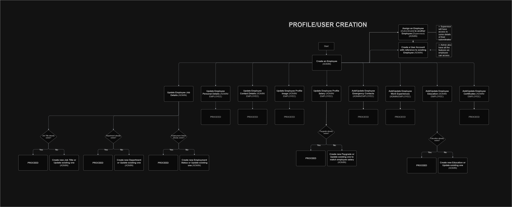
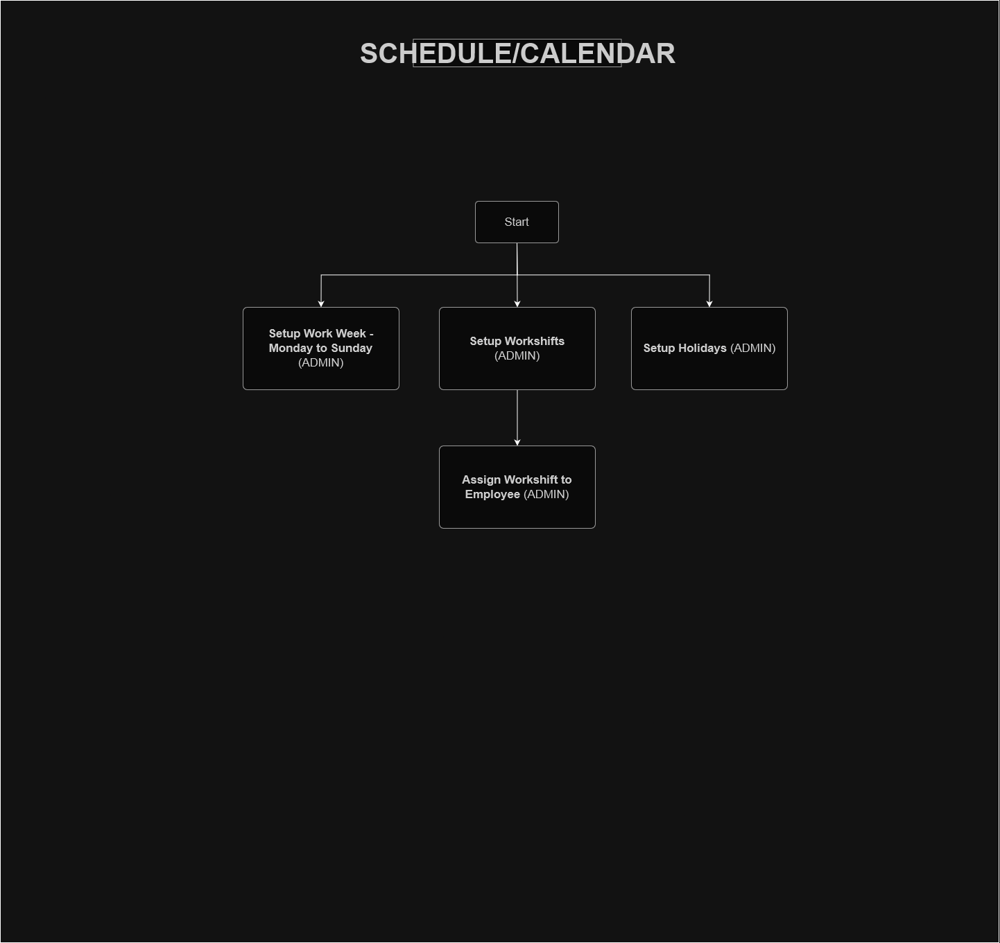
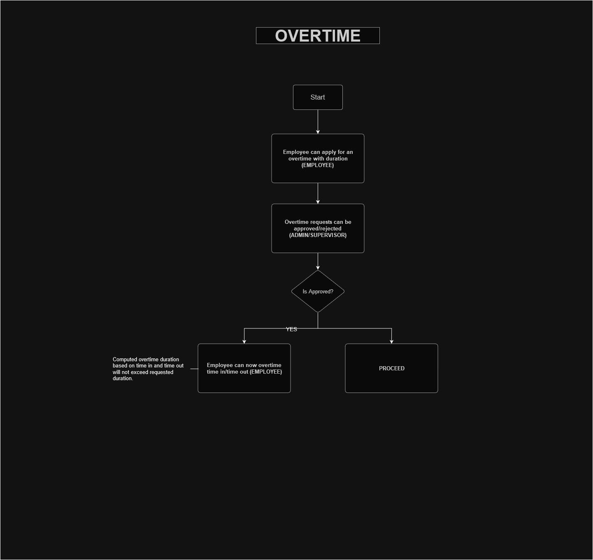
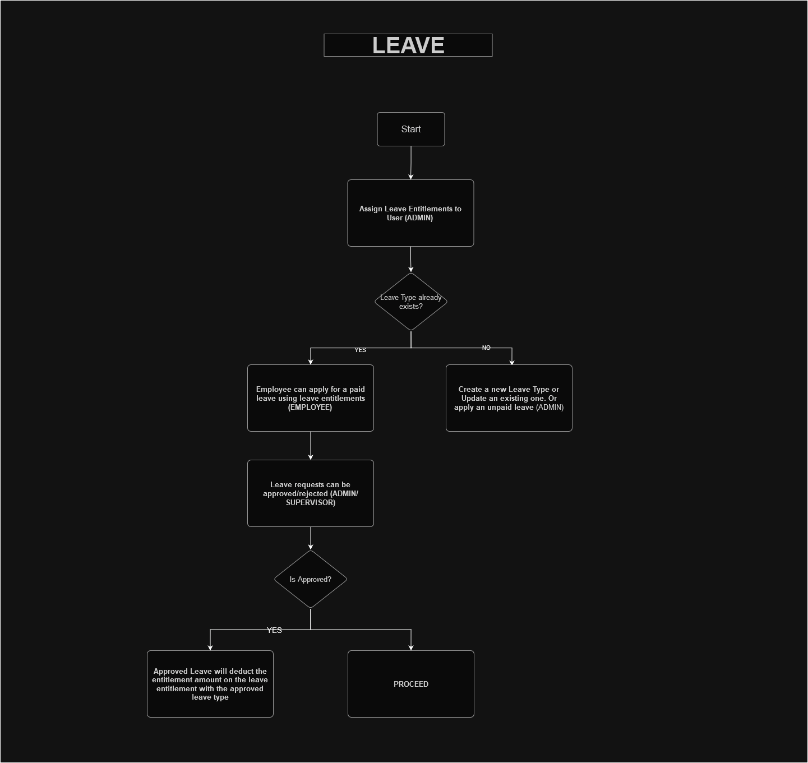
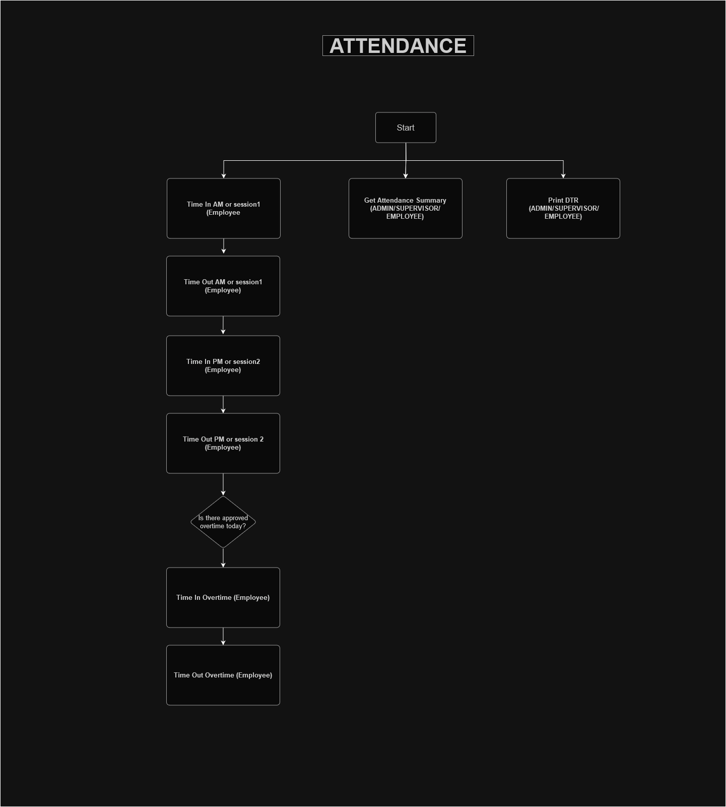
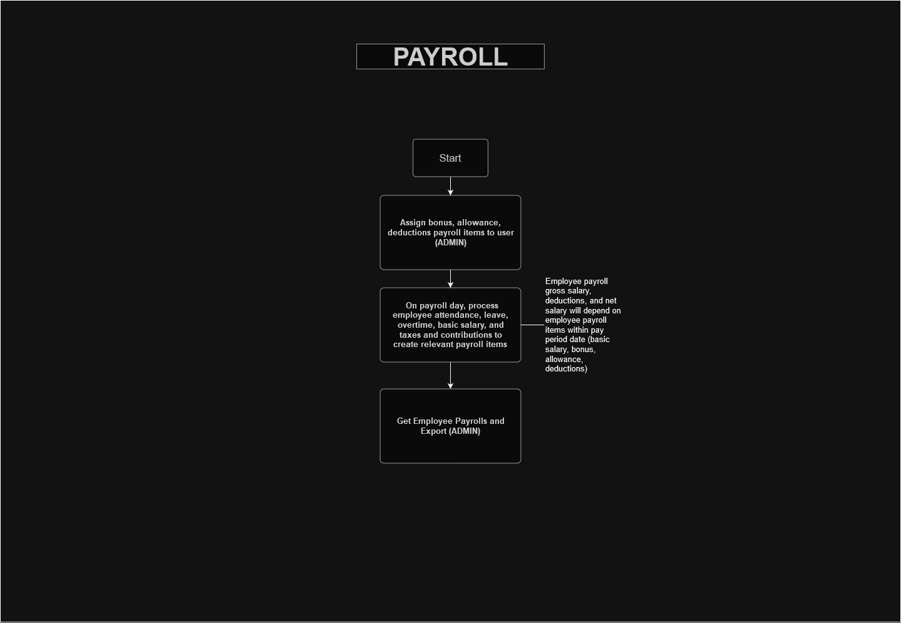

# HR processes and API

The original HR side of the system (2024): how each process flows, and the API endpoints behind it. Payroll has since moved to the Philippine payroll engine under `/api/payroll`; see the main README.

## Process Flowchart

### Profile Creation

### Schedule

### Overtime

### Leave

### Attendance

### Payroll

## Process List

**Job Title**
1. Create, Update, or Delete Job Title 
	- POST/PUT/DELETE /api/jobtitle (admin)
2. Assign/Change employee job title 
	- PUT /api/employee/{id}/jobDetails (admin)

**Employment Status**
1. Create, Update, or Delete Employment Status
	- POST/PUT/DELETE /api/employmentstatus/ (admin)
2. Assign/Update employee Employment Status
	- PUT /api/employee/{id}/employmentstatus/ (admin)

**Department**
1. Create, Update, or Delete Department
	- POST/PUT/DELETE /api/department/ (admin)
2. Assign/Update employee Department as admin or employee
	- PUT /api/employee/{id}/department/ (admin)

**Employee Certificates**
1. Add, Update, or Delete Employee Certificate 
	- POST/PUT/DELETE /api/employee/{employeeId}/certificates (admin/supervisor/employee)

**Work Experience**
1. Add, Update, or Delete to Employee Work Experiences as admin or employee
	- POST/PUT/DELETE /api/employee/{employeeId}/workexperience (admin/supervisor/employee)

**Emergency Contact**
1. Add, Update, or Delete to Employee Emergency Contacts as admin or employee
	- POST/PUT/DELETE /api/employee/{employeeId}/emergencycontact (admin/supervisor/employee)

**Education**
1. Create, Update, or Delete Education
	- POST/PUT/DELETE /api/education (admin)
1. Assign/Update/Remove Employee Education as admin or employee
	- POST/PUT/DELETE /api/employee/{employeeId}/education (admin/supervisor/employee)

**Employee**
1. Create a new employee with optional personal, contact, and job details
	- POST /api/employee (admin)
2. Update personal, contact, job, and contribution details of employee
	- PUT /api/employee/{employeeId}/ (admin/supervisor/employee)

**USER CREATION**
1. Create a user with reference to an existing employee
	- POST /api/user (admin)
- Admins also have access to all available employee features

**Work Week**
1. Setup work week schedule for company as admin
	- Adding new work week schedule will invalidate current one
2. Get or Update work week
	- GET/PUT /api/workweek (admin)

**Holiday**
1. Create, Update, or Delete Holiday
	- POST/PUT/DELETE /api/holiday (admin)

**Work Shift**
 1. Create, Update, or Delete workshift 
 	- POST/PUT/DELETE /api/workshift (admin)
 2. Add/Remove Employee Workshift as Admin or Supervisor
 	- PUT /api/employee/assignWorkShift or /api/employee/removeWorkShift (admin/supervisor) 

**Leave**
1. Assign Leave Entitlements by Leave Type to User
	- POST /api/leaveentitlement (admin)
2. Employee can apply for a paid leave using leave entitlements (if no entitlement, it is considered an unpaid leave); 
	- POST /api/leave (employee)
3. Leave requests can be approved/rejected by admin or supervisor of employee
	- POST /api/leave/approve or /api/leave/reject (admin/supervisor)
4. Approved Leave will deduct the entitlement amount on the leave entitlement with the approved leave leave type

**Overtime**
1. Employee can apply for overtime with duration
	- POST /api/overtime (employee)
2. Overtime requests can be approved/rejected by admin or supervisor of employee
	- POST /api/overtime/approve or /api/overtime/reject (admin/supervisor)
3. With approved overtime, the employee will be able to time in/time out on overtime of attendance record. The final overtime duration will depend on time in and out.

**Attendance**
1. Time In/Time Out as employee
	- based on time, the relevant session will be added session1 - am or session2 - pm
	- POST /api/attendance/timein or /api/attendance/timeout (employee)
2. Update/Delete existing attendance item .
	- PUT/DELETE /api/attendance/{attendanceId} (admin/supervisor/employee)
3. Get employee attendance summary as employee, supervisor, admin.
	- GET /api/employee/{employeeId/attendanceSummary (admin/supervisor/employee)
4. Print employee DTR as employee or admin.
	- GET /api/employee/{employeeId/downloadDtr
5. Missing attendance on a date will be considered absent if have a work week, not a holiday, or there is no existing leave

**Salary**
1. Create/Update/Delete paygrade as admin
	- POST/PUT/DELETE /api/paygrade
2. Create/Update a basic salary within pay grade to employee as admin
	- POST/PUT /api/employee/{employeeId}/salary (admin)

**Payroll**
1. Employee payroll will depend on payroll items like ledger (basic salary, bonus, allowance, deductions)
2. Assign bonus, allowance, deductions payroll items to user as admin
	- Taxes and Contributions are considered as deductions
	- Absences, Unpaid leaves, and Undertime are considered as deductions
	- Overtime Duration will be multiplied to hourly rate as bonus
	- POST/PUT/DELETE /api/payrollitem (admin)
3. Get Payrolls or export with date
	- GET /api/payroll/ or /api/payroll/export (admin)

